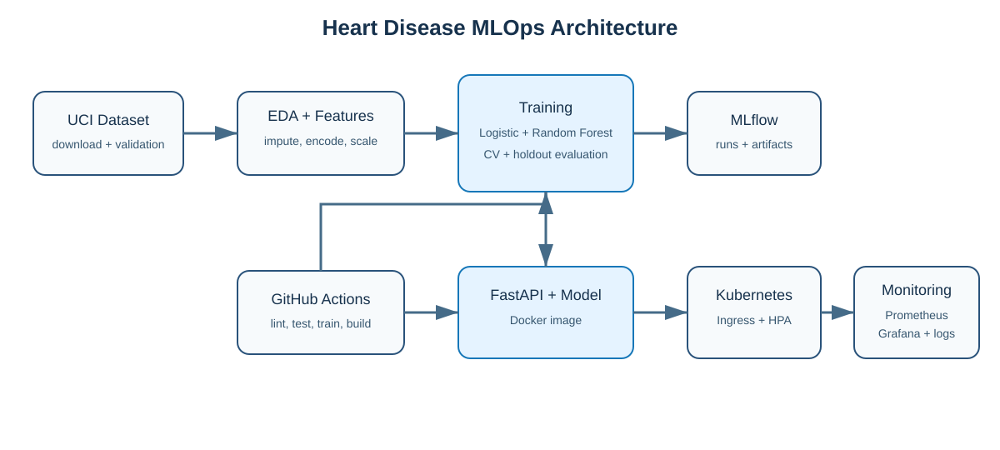

# Heart Disease MLOps Assignment 01

An end-to-end, reproducible MLOps implementation for the UCI Heart Disease
classification problem. The project covers data acquisition, EDA, feature
engineering, model comparison, MLflow tracking, automated tests, CI/CD,
FastAPI serving, Docker, Kubernetes, Prometheus/Grafana monitoring, and report
generation.

## Architecture



## Quick start

```bash
python3 -m venv .venv
source .venv/bin/activate
python -m pip install --upgrade pip
python -m pip install -r requirements-dev.txt
python -m pip install --no-deps -e .

python scripts/download_data.py
python scripts/run_eda.py
python -m heart_disease_mlops.train
pytest

uvicorn heart_disease_mlops.api:app --host 0.0.0.0 --port 8000
```

In another terminal:

```bash
curl http://127.0.0.1:8000/health
curl -X POST http://127.0.0.1:8000/predict \
  -H 'Content-Type: application/json' \
  --data @examples/sample_request.json
```

Interactive API documentation is available at `http://127.0.0.1:8000/docs`,
and Prometheus metrics are exposed at `http://127.0.0.1:8000/metrics`.

## Main commands

```bash
make setup       # create .venv and install dependencies
make data        # download and clean the UCI data
make eda         # generate professional EDA outputs
make train       # compare models and save the winner
make test        # run unit and API tests
make lint        # run Ruff checks
make report      # create reports/Assignment_01_Report.docx
make docker      # build the serving image
make compose-up  # start API, Prometheus, and Grafana
```

## Reproducibility

- Random seed: `42`
- Raw source: UCI processed Cleveland Heart Disease data
- Target: original diagnosis `> 0` mapped to heart-disease risk `1`
- Split: stratified 80/20 holdout
- Selection metric: holdout ROC-AUC, supported by five-fold CV
- Saved model: complete scikit-learn preprocessing and estimator pipeline
- Experiment store: local SQLite MLflow backend at `mlflow.db`

## Deployment

Build and run locally:

```bash
docker build -t heart-disease-api:1.0.0 .
docker run --rm -p 8000:8000 heart-disease-api:1.0.0
```

For Kubernetes/Minikube and monitoring instructions, see
[`deployment/README.md`](deployment/README.md) and
[`monitoring/README.md`](monitoring/README.md).

## Submission evidence

The repository includes an evidence checklist in [`screenshots/README.md`](screenshots/README.md)
and a recording plan in [`video/RECORDING_GUIDE.md`](video/RECORDING_GUIDE.md).
These files deliberately require real screenshots and a real recording from the
student's environment; no execution evidence is fabricated.

For a complete execution sequence on the target machine, use
[`TARGET_ENV_RUNBOOK.md`](TARGET_ENV_RUNBOOK.md).

## Project layout

```text
src/heart_disease_mlops/  reusable data, training, and API code
scripts/                  acquisition, EDA, report, and smoke-test scripts
tests/                    unit and API tests
data/                     raw and cleaned datasets
models/                   packaged winning pipeline and metadata
outputs/                  EDA and model evaluation artifacts
deployment/               Kubernetes manifests
monitoring/               Prometheus and Grafana configuration
reports/                  report source and generated DOCX
screenshots/               required evidence checklist
video/                     recording script and checklist
```
